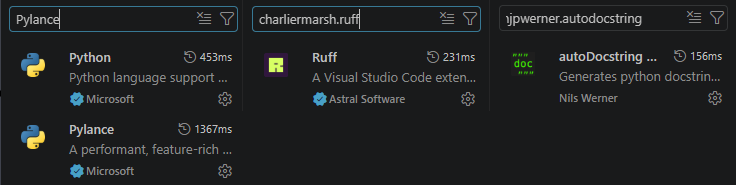
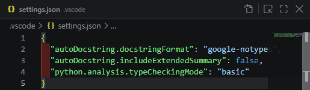
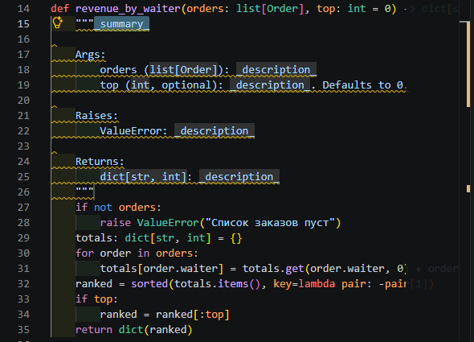
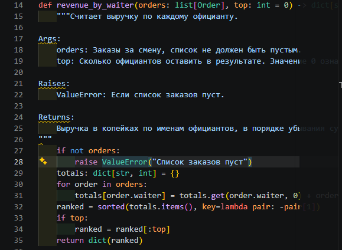
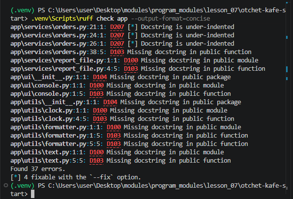
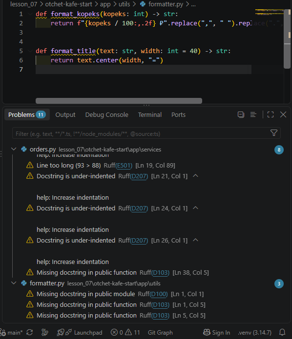
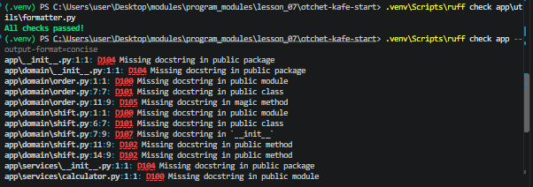

# Отчёт · Докстринги в VS Code: генератор и проверка

**Студент:** Гаврилов Владислав, группа РПО/1
**Номер в журнале:** 1, вариант шагов 7 и 10: 1, модуль `app/utils/formatter.py`

Работа выполнена на втором архиве проекта «Отчёт кафе»
(`lesson_07/otchet-kafe-start`), глава 4.10

## 1. Расширения

Установлены расширения `njpwerner.autodocstring` и `charliermarsh.ruff`.
Автор autoDocstring на карточке расширения: **Nils Werner**. Издатель Ruff: **Astral Software**.



## 2. Настройки проекта

Настройки генератора записаны в файл **`.vscode/settings.json`**. Он лежит внутри проекта
и попадает в репозиторий, поэтому заготовка у всех, кто откроет проект,
будет **одинаковой**.



Формат заготовки — **`google-notypes`**. С проверкой Ruff он согласуется, потому что
в `pyproject.toml` записано `convention = "google"`. Настройка
`startOnNewLine` оставлена **`false`**: иначе Ruff выдаст замечание **`D212`**.

## 3. Заготовка генератора

Генератор вызван у функции `revenue_by_waiter` способом: **нажатием `Ctrl + Shift + 2` (или вводом трёх кавычек и Enter)**.



В заготовке разделы **`Args:`**, **`Raises:`** и **`Returns:`**. Раздел `Raises:` появился,
потому что в теле функции есть **`raise ValueError`**. Типов в скобках нет, потому что
выбран формат **`google-notypes`**.

## 4. Заполненный докстринг



Краткая строка: «**Считает выручку по каждому официанту.**». Параметр `top` описан так: «**Сколько официантов оставить в результате. Значение 0 означает, что возвращаются все.**».

## 5. Проверка всего пакета

Команда `ruff check app --output-format=concise` закончилась строкой
`Found 37 errors.` (до исправлений).



Чаще других в выводе два кода. `D100` означает: **отсутствует докстринг у модуля**.
`D103` означает: **отсутствует докстринг у публичной функции**.

## 6. Замечания в редакторе

Модуль моего варианта — `app/utils/formatter.py`. В панели Problems у него **3** замечания.
Источник у каждого замечания — **`Ruff(D...)`**.



## 7. Модуль orders.py без замечаний

Докстринг модуля `orders.py`: «**Модуль для работы с заказами в кафе.**».
Докстринг `sort_orders_in_place`: «**Сортирует список заказов на месте по убыванию суммы.**».


## 8. Опыт с D417

После удаления строки про `top` проверка вывела:
`app\services\orders.py:16:5: D417 Missing argument description in the docstring for `revenue_by_waiter`: `top``.


Правило D417 сравнивает раздел `Args:` с **фактической подписью функции**. Остальные правила
из вывода проверяют, есть ли докстринг и как он оформлен. После опыта
строка про `top` возвращена.

## 9. Модуль моего варианта

До работы проверка модуля `app/utils/formatter.py` выводила `Found 3 errors.`, после —
`All checks passed!`. В пакете `app` осталось `Found 2 errors.` (там остались ошибки в других файлах, которые мы не трогали).



Докстринг одной из функций модуля:

```python
def format_title(text: str, width: int = 40) -> str:
    """Форматирует текст заголовка, добавляя символы по краям.

    Args:
        text: Исходный текст заголовка.
        width: Общая ширина строки после форматирования. По умолчанию 40.

    Returns:
        Отформатированная строка с добавленными символами.
    """
    return text.center(width, "=")